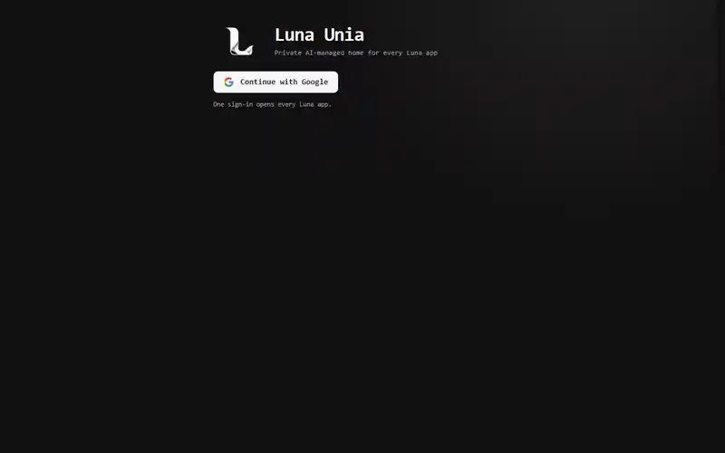
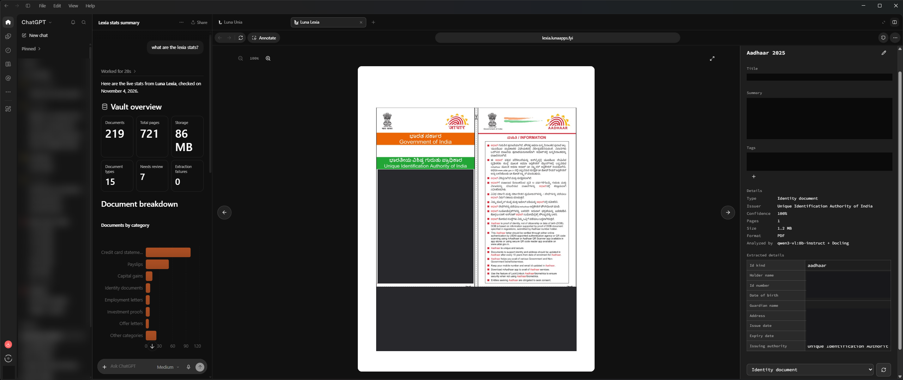

# Luna Lexia


**A private vault for your documents that reads them for you.** Payslips, Form 16s, bank and card statements,
invoices, policies, certificates, lab reports: Lexia reads each one with a local model, pulls out its details into a
checked, structured record, and lets you and your AI assistant search, analyze and correct them.

<p align="center">
  <a href="docs/assets/luna-lexia-showcase.mp4"></a>
</p>

<p align="center"><em>Uploading and reading documents (a demo account with made-up documents), then an assistant
building a spending analysis through Lexia's tools. Select it for the sharper video.</em></p>

## What it does

- **Bring documents in** from this device, a Google Drive folder, or a Gmail search; password-protected PDFs too.
- **Reads every page** with [Docling](https://github.com/docling-project/docling) (text, OCR, tables), on the GPU
  when there is one.
- **Knows 28 document types** and extracts each one's details, such as pay lines, TDS, transactions, GST, policy
  terms or lab results, into validated schemas.
- **Checks them:** net pay against gross minus deductions, balances against transactions, totals against lines.
  Anything that doesn't add up is flagged for review.
- **Search by words or meaning**, and ask questions answered from your own documents, with sources.
- **Browse and correct:** sort by relevance, date, size or name; favourite, hide, rename, and edit any extracted field.

<p align="center">
  
</p>

The full list of types, with what each extracts and checks, is in
[Architecture](https://github.com/pranjallk1995/Luna_Lexia/wiki/Architecture#document-types).

## Quickstart

Lexia runs on [Luna Sentia](https://github.com/pranjallk1995/Luna_Sentia), which provides its database, model and
sign-in. On one machine you need no `.env`:

```sh
git clone https://github.com/pranjallk1995/Luna_Sentia.git
git clone https://github.com/pranjallk1995/Luna_Lexia.git
./Luna_Sentia/luna.sh start lexia
```

Open <http://localhost:18501> and sign in as Sentia's owner. Before giving Lexia a public address, set your own
secrets: see [Getting started](https://github.com/pranjallk1995/Luna_Lexia/wiki/Getting-Started).

## Connect your AI assistant

Add `https://<your lexia MCP host>/mcp` to Claude, ChatGPT or any MCP client as a custom connector (OAuth). Because
every document's details are structured, the assistant can work across them: "income against card spending this
year" finds the payslips and statements and builds the report. Every tool is listed in
[MCP tools](https://github.com/pranjallk1995/Luna_Lexia/wiki/MCP-Tools).

## Works with

- **[Luna Vita](https://github.com/pranjallk1995/Luna_Vita)** shows your lab reports from Lexia, with ranges and trends.
- **[Luna Fiora](https://github.com/pranjallk1995/Luna_Fiora)** uses the extracted tax and salary details.

Both read Lexia with its private `LUNALEXIA_API_TOKEN`, one person's documents at a time; see
[Architecture](https://github.com/pranjallk1995/Luna_Lexia/wiki/Architecture#luna-vita-integration).

## Documentation

The [wiki](https://github.com/pranjallk1995/Luna_Lexia/wiki) has the full reference:

| Page | What's in it |
| --- | --- |
| [Home](https://github.com/pranjallk1995/Luna_Lexia/wiki) | Every feature and the web UI in detail |
| [Getting started](https://github.com/pranjallk1995/Luna_Lexia/wiki/Getting-Started) | Setup, `.env`, sign-in, Google Drive and Gmail |
| [MCP tools](https://github.com/pranjallk1995/Luna_Lexia/wiki/MCP-Tools) | Every tool your assistant can call |
| [Architecture](https://github.com/pranjallk1995/Luna_Lexia/wiki/Architecture) | How a document is processed, document types, search, model, data model and database diagram |
| [Development](https://github.com/pranjallk1995/Luna_Lexia/wiki/Development) | Project structure, schemas, tests, model evaluations |

The UI follows [UI_STYLE_GUIDE.md](UI_STYLE_GUIDE.md).

## Releases and development

Releases are on the [Releases page](https://github.com/pranjallk1995/Luna_Lexia/releases). To update: `git pull`, then
`./Luna_Sentia/luna.sh start lexia`. To run your local code and reload it as you edit:
`./Luna_Sentia/luna.sh start --build --watch lexia`.
