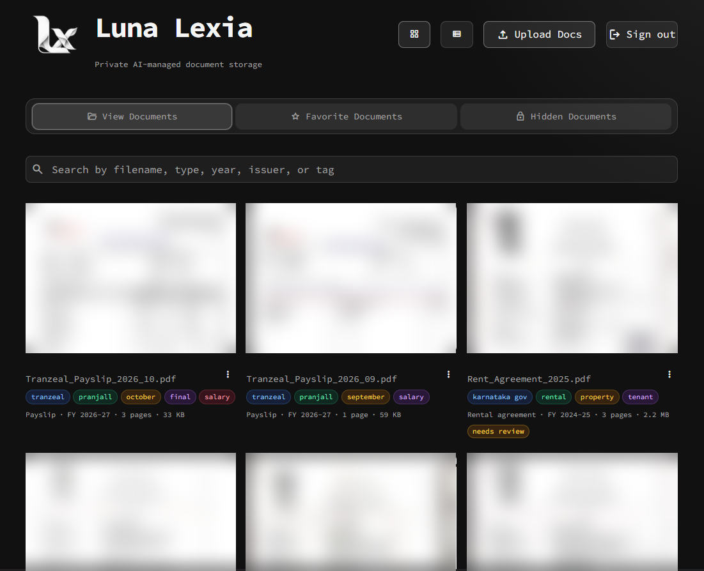
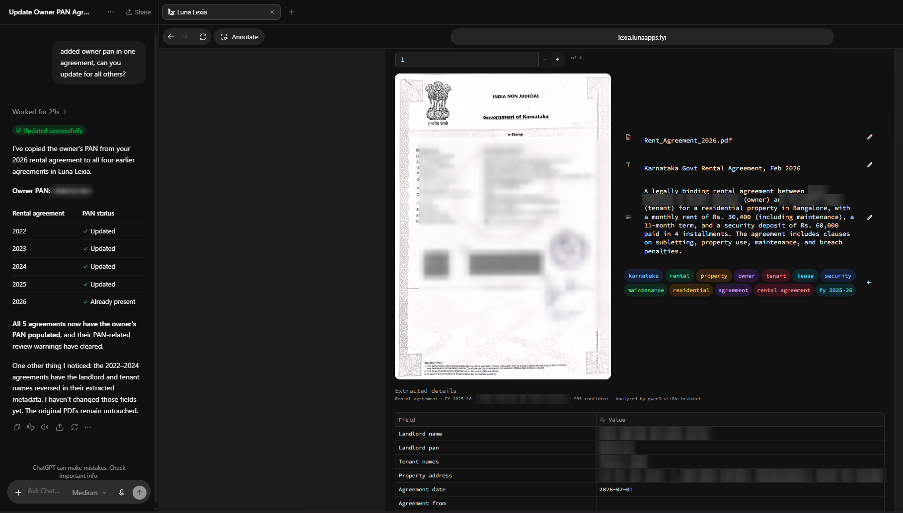
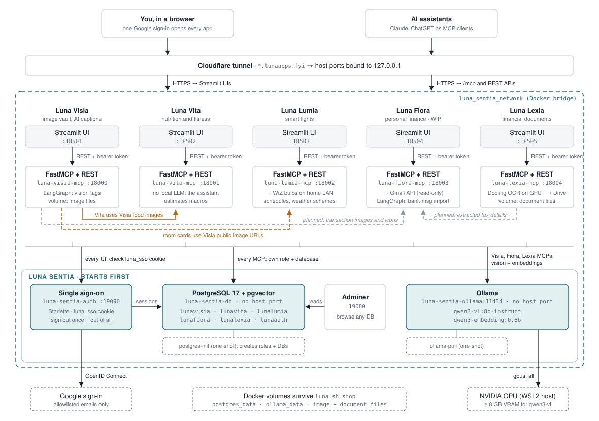

# Luna Lexia


## Store, read, and search your financial documents with LLMs

> **Work in progress:** Luna Lexia is a local-first and desktop-first document store under active development.

Luna Lexia is the document counterpart of [Luna Visia](https://github.com/pranjallk1995/Luna_Visia):
a private vault for payslips, Form 16s, bank statements, tax proofs, and other
personal finance documents. Every upload is read with Docling (text, OCR,
tables), classified by a local model served by [Luna Sentia](https://github.com/pranjallk1995/Luna_Sentia),
and its type-specific details are extracted into validated Pydantic schemas.
Business rules then check the details, such as net pay against gross pay minus
deductions, and flag anything that needs a person to review it.

The extracted details are what [Luna Fiora](https://github.com/pranjallk1995/Luna_Fiora)
needs to prepare tax-filing supporting documents and track finances, in the
same way Luna Vita uses Luna Visia. MCP tools let any assistant list, search,
read, download, upload, rename, correct, and delete documents.

<p align="center">
  
</p>

The Streamlit interface lets you upload, search, view, favorite, hide, and
correct documents; each card shows the document type, financial year, size, and
tags, and anything that needs review is flagged.

<p align="center">
  
</p>

Any assistant connected over MCP works on the same library. Here ChatGPT, asked
to copy the owner's PAN from one rental agreement into the others, corrects the
extracted details of all five agreements; their review warnings clear, and the
original PDFs are untouched.

> **Requires Luna Sentia, running and healthy:** Luna Lexia keeps its data in Luna Sentia's PostgreSQL (`luna-sentia-db`) and joins Sentia's `luna_sentia_network`; it has no database of its own. Start [Luna Sentia](https://github.com/pranjallk1995/Luna_Sentia) first and wait until its `postgres` and `ollama` services report healthy, as described under [Start](#start). Sentia also serves the model: Lexia uses `qwen3-vl:8b-instruct` by default, which Sentia pulls with its other models.

## How a document is processed

```text
Upload (UI, MCP tool, upload link, or HTTP API)
  -> unlock     a password-protected PDF is opened with its password and stored unlocked
  -> Docling    text layer, OCR for scanned pages, tables as Markdown, one entry per page
  -> classify   Pydantic AI agent: doc_type, title, summary, tags, confidence
  -> extract    Pydantic AI agent with the doc_type's schema as constrained JSON output
  -> validate   Pydantic schema checks (retried with the errors fed back to the model),
                then business rules that produce review flags
  -> store      file in the document volume, record and page text in PostgreSQL
```

Parsing through tagging runs in `mcp/app/services/pipeline.py`. When
extraction from the parsed text fails, or the document has no readable text,
extraction is tried from page images; a document read that way is flagged for
review.

- **Docling** turns PDFs and photos into Markdown page by page, so scans become
  text (RapidOCR) and every page stays citable. If Docling fails, the PDF's own
  text layer is used so an upload is never lost.
- **Pydantic AI** runs two agents on Luna Sentia's model. A schema violation is
  sent back to the model with the validation errors for another attempt.
  Lexia talks to Ollama's native `/api/chat` endpoint through a small adapter
  (`mcp/app/integrations/ollama.py`): Ollama's OpenAI-compatible endpoint
  ignores per-request options and would cap every request at a 4,096-token
  context, too small for a multi-page Form 16.
- **Review flags** come from business rules, not model retries, because asking a
  small model to make printed numbers agree invites it to invent them. Flagged
  documents carry the `needs review` tag until the details are corrected or
  marked reviewed.

Fields are nullable: a value that is not printed stays `null` and is never
guessed. Validators accept the formats Indian documents print (`1,23,456.00`,
`31/03/2025`, `FY 2024-2025`, masked PANs) and normalize them. Dates are copied
from the document as printed and parsed by the schema, which proved far more
reliable than asking a 7B model to reformat them.

## Document types

| `doc_type` | Examples | Key details extracted | Business rules |
| --- | --- | --- | --- |
| `payslip` | Monthly salary slip | Employer, employee, PAN, UAN, pay period, earnings and deduction lines, gross, deductions, TDS, PF, net pay | Gross − deductions = net pay; lines add up to totals; valid PAN |
| `form_16` | Form 16 Part A and B | Employer TAN/PAN, employee PAN, AY/FY, regime, quarterly TDS, salary under 17(1)–(3), section 10 exemptions, standard deduction, Chapter VI-A deductions, taxable income, tax, cess, net tax payable | Quarterly TDS = total; salary head and tax computations add up; AY follows FY; employee PAN present |
| `tax_statement` | Form 26AS, AIS, TIS, yearly tax computation sheets | TDS entries by deductor and section, TCS, advance and self-assessment tax, reported salary, interest, dividends; computed income and tax | TDS entries add up to the total |
| `itr_acknowledgement` | ITR-V, return summary | ITR form, AY, acknowledgement number, filing date and section, income, tax paid, refund or balance | Not both a refund and tax due |
| `bank_statement` | Savings or current account statement | Bank, holder, account (last 4), IFSC, period, opening and closing balance, totals, interest, up to 100 transactions | Opening + credits − debits = closing; running balance per transaction; dates within the period |
| `credit_card_statement` | Card bill | Issuer, card (last 4), statement and due dates, total and minimum due, credit limit, up to 100 transactions | Minimum due ≤ total due; due date after statement date |
| `invoice` | Invoices, receipts, utility and telecom bills | Vendor and GSTIN, invoice number and date, category, line items, CGST/SGST/IGST, total, payment status | Subtotal − discount + tax = total; GST parts = total tax; lines = subtotal |
| `rent_receipt` | HRA rent receipts | Landlord and PAN, tenant, address, period, monthly rent, amount | Landlord PAN required above ₹1,00,000 annual rent |
| `investment_proof` | 80C/80D/80G proofs: insurance, ELSS, PPF, NPS, tuition, donations | Kind, section, provider, policy or account, payment date, amount, eligible deduction | — |
| `loan_statement` | Loan agreements, sanction letters, repayment schedules, interest certificates | Lender, borrowers, loan type, agreement date, amount, rate, tenure, EMI and its first and last dates, principal and interest paid, outstanding | EMIs × tenure cover the loan amount |
| `capital_gains_statement` | Broker, AMC, CAMS, or KFintech gains statement | FY, short- and long-term gains, entries by security | Short + long term = total gain |
| `identity_document` | PAN, Aadhaar, passport, licence, voter ID | Holder, number, date of birth, issue and expiry dates | Not expired |
| `offer_letter` | Job offers | Employer, designation, location, offer and joining dates, annual CTC, fixed and variable pay, bonuses, stock grant, CTC components, probation, notice period | Components add up to the CTC; joining after the offer |
| `employment_letter` | Appointment, experience, relieving, service certificate, resignation, promotion, increment letters | Letter kind, employer, employee and ID, designation, employment dates, reason, revised CTC, signatory | — |
| `resume` | Resumes and CVs | Name, contact details, headline, experience years, roles (employer, title, months), education, skills, certifications, links | — |
| `educational_certificate` | Degrees, marksheets, transcripts, SSC/HSC certificates, leaving certificates, hall tickets, score cards | Kind, holder, institution, board or university, program, semester, seat number, result, CGPA, percentage, issue date | Percentage within 0–100; CGPA within its scale; a degree has no semester |
| `recognition` | Awards, appreciation, recommendations, course certificates | Kind, title, recipient, organization, author, date, period | — |
| `rental_agreement` | Lease or leave-and-licence agreements | Landlord and PAN, tenants, address, term, lock-in, rent, maintenance, deposit, escalation, registration | Landlord PAN required above ₹1,00,000 annual rent |
| `insurance_policy` | Health, life, motor, home, travel policy schedules | Kind, insurer, policy number, policyholder, insured, nominee, period, sum insured, IDV, vehicle, premium and GST | Premium + GST = total; policy not lapsed; a policy naming a vehicle is a motor policy |
| `vehicle_registration` | Vehicle RC | Registration number, owner, class, maker, model, fuel, chassis and engine numbers, validity, RTO, financier | Registration not expired |
| `bank_account_proof` | Cancelled cheques, cheque books, passbook front pages, bank letters | Bank, holder, account (last 4), type, IFSC, MICR, branch | Valid IFSC |
| `provident_fund_document` | UAN card, PF Form 11 and Form 2, EPS and gratuity forms, PF passbook | Kind, member, UAN, PF account, establishment, joining date, nominees and shares, balances | Nominee shares total 100%; passbooks show a balance |
| `legal_document` | Legal notices, NDAs, contracts, affidavits, powers of attorney, court orders | Kind, parties, advocate, date, reference, subject, demands, deadline, amount claimed, effective dates | — |
| `medical_record` | Medical and fitness reports, prescriptions, lab reports, discharge summaries, bills | Kind, patient, provider, doctor, date, purpose, findings, fitness, amount paid | — |
| `other` | Anything else, such as onboarding and verification forms and cover letters | Issuer, recipient, date, reference, key amounts and dates | — |

Every type also gets generic checks: `*_from` dates before `*_to` dates, PAN,
TAN, GSTIN, and IFSC formats, and the type's key amount being present (for
types where every such document has one). Identity, education, career, legal,
medical, vehicle, PF, and bank-proof documents are not given a financial year
from their dates, so a 2017 marksheet is not tagged `fy 2017-18`. The
full JSON schema of each type is available from `list_document_types` and
`GET /api/document-types`. Schemas live in `mcp/app/core/schemas.py`; bump
`SCHEMA_VERSION` after changing one so `start_reanalysis` re-extracts older
records.

Each record also stores indexed key facts: `financial_year` (the Indian
April–March year, from the document's own FY, its AY minus one, or its date),
`document_date`, `issuer`, and `primary_amount` (net pay, total TDS, closing
balance, invoice total, and so on). Every document is tagged with its type and
`fy 2024-25`-style year.

## Luna Fiora integration

Fiora reads Lexia over the shared Docker network with the private
`LUNALEXIA_API_TOKEN`, the same way Vita reads Visia's catalog. Unlike Visia's
image metadata, document metadata holds PANs and salaries, so **every
metadata route requires the token**:

```sh
curl -H "Authorization: Bearer $LUNALEXIA_API_TOKEN" \
  "http://luna-lexia-mcp:8000/api/metadata?doc_type=payslip&doc_type=form_16&financial_year=2024-25"
```

| Route | Purpose |
| --- | --- |
| `GET /api/metadata?doc_type=…&financial_year=…` | Visible documents with their `extracted` details and `review_flags` (repeat `doc_type` for several) |
| `GET /api/document-types` | Every type with its field schema |
| `GET /api/documents/{name}` | One document's full record and file properties |
| `GET /api/documents/{name}/text?first_page=&last_page=` | Parsed Markdown per page |
| `GET /api/public/documents/{document_id}` | The original file, by immutable ID (open, unguessable link) |

Treat documents with `review_flags` as unconfirmed, and read `null` fields as
"not printed", not zero. Store the immutable `document_id` (or `public_url`)
rather than the filename when linking a Fiora record to its supporting document.

## Luna ecosystem



Every Luna app is a Streamlit UI plus a FastMCP service on Luna Sentia's
`luna_sentia_network`: its data lives in Sentia's PostgreSQL, people sign in
through Sentia's `auth`, and model calls go to Sentia's Ollama. Orange lines are
the calls between apps; grey dashed lines are planned links into Fiora: Lexia's
extracted tax details and Visia's transaction images and icons.

## Start

Start [Luna Sentia](https://github.com/pranjallk1995/Luna_Sentia) first and wait until it is healthy. Sentia runs
the PostgreSQL server that holds Lexia's `lunalexia` database, serves the models,
and creates the shared `luna_sentia_network` every Luna app joins. Lexia has no
database of its own: started before Sentia is healthy, it cannot reach its
data and keeps restarting until it can.

```sh
cd ../Luna_Sentia
docker compose up -d --wait postgres ollama adminer
docker compose run --rm postgres-init   # creates the lunalexia role and database
docker compose ps                       # postgres and ollama must show (healthy)
```

See [Is Sentia healthy?](https://github.com/pranjallk1995/Luna_Sentia#is-sentia-healthy) if they do not.
Or start Sentia and every app in order with `../luna.sh start` (Lexia is part
of the default app list).

Create a private `.env` from `.env.example`:

```dotenv
# Must equal LUNALEXIA_DB_PASSWORD in Luna_Sentia/.env
POSTGRES_PASSWORD=replace-with-a-private-database-password
DOCUMENT_MODEL=qwen3-vl:8b-instruct
PAGE_IMAGES_WITH_TEXT=true
DOCLING_DEVICE=auto
LUNALEXIA_PUBLIC_BASE_URL=
LUNALEXIA_API_TOKEN=replace-with-a-random-value-of-at-least-32-characters
LUNALEXIA_ALLOWED_EMAILS=you@example.com
MCP_PUBLIC_URL=http://localhost:18004
```

`LUNALEXIA_API_TOKEN` is a shared secret between the UI, the MCP server, and
peer apps such as Fiora. Generate it with `openssl rand -hex 32`.
`LUNALEXIA_PUBLIC_BASE_URL` is optional: without it documents have no
`public_url`, and ZIP download and upload links are unavailable; set it (here or
with the `set_public_base_url` tool) to the public HTTPS origin of the MCP server
to enable them.

### Sign-in

Lexia signs people in through Luna Sentia's single sign-on: one Google sign-in at
Sentia opens every Luna app, and **Sign out** in any app signs out of all of them.
Lexia's UI needs no Google client of its own; `ui/.streamlit/secrets.toml` now
only supplies the Google client the backend reuses for [Google Drive import](#google-drive-import).
Set in `.env`:

- `LUNA_SSO_URL`: Sentia's public sign-on address (`SENTIA_AUTH_PUBLIC_URL` in
  Sentia's `.env`), for example `https://auth.lunaapps.fyi`.
- `LUNA_SSO_INTERNAL_URL`: `http://luna-sentia-auth:8000`, where Lexia checks
  sessions over `luna_sentia_network`.
- `LUNALEXIA_ALLOWED_EMAILS`: the accounts allowed into Lexia, checked
  after Sentia confirms who is signed in.

Sentia's auth service must be healthy before Lexia can sign anyone in; see
[Single sign-on](https://github.com/pranjallk1995/Luna_Sentia#single-sign-on) for its setup.

Start Luna Lexia:

```sh
docker compose up --build
```

The first build downloads PyTorch for CUDA 13.0 and Docling's layout, table, and
OCR models into the image (about 11.6 GB), so uploads never wait on downloads and
parsing works without internet access.

- UI: <http://127.0.0.1:18505>
- Service health: <http://127.0.0.1:18004/health>
- MCP endpoint: <http://127.0.0.1:18004/mcp>

| Setting | Default |
| --- | --- |
| Database | `lunalexia` |
| Username | `lunalexia` |
| Password | `lunalexia-dev` |
| Database host inside Docker | `luna-sentia-db` |

Analysis takes about 10–40 seconds per document, almost all of it the two model
calls to Sentia; Docling parses a page in well under a second on the GPU. Inspect
the database with
[Adminer in Luna Sentia](https://github.com/pranjallk1995/Luna_Sentia#database-ui)
using server `luna-sentia-db`.

### GPU parsing

The MCP service is given the GPU (`gpus: all`), and Docling runs its layout,
table, and OCR models there. `DOCLING_DEVICE` selects the device: `auto` (the
default) uses a CUDA GPU when one is visible and the CPU otherwise, while `cuda`
or `cpu` force one. On an RTX 5070, a scanned page takes about 0.4 s instead of
2 s on the CPU and a text PDF about 15 times less, using under 1 GB of GPU
memory beside Ollama's model. On a machine without an NVIDIA GPU, remove
`gpus: all` from the `mcp` service; parsing then runs on the CPU.

### Model and context

`DOCUMENT_MODEL` (`qwen3-vl:8b-instruct`) must be listed in Sentia's `SENTIA_MODELS`.
Use the `-instruct` tag: plain `qwen3-vl:8b` is the thinking variant, which
reasons at length before every reply and ignores Lexia's JSON schema while it does.
Lexia asks Ollama for a 16,384-token context per request (`context_tokens` in
`mcp/app/core/config.py`) and sends at most 24,000 characters of document text.
With `PAGE_IMAGES_WITH_TEXT=true` (the default), images of the first three pages
go beside that text, so the model sees which label each value is printed under;
set it to `false` for faster, text-only analysis. Visia and Fiora use the same
model, so Ollama keeps one model loaded for all three apps.

A PAN, TAN, GSTIN, or IFSC that does not have its official format is sent back
to the model once to be re-read; if it is still malformed, the document keeps it
and is flagged for review.

### Google Drive import

Drive import reuses the UI's Google OAuth client and needs no settings of its
own. In Google Cloud, on that client's project:
1. Enable the **Google Drive API**.
2. Add `<MCP_PUBLIC_URL>/api/drive/callback` to the client's redirect URIs.
3. Set the consent screen to **In production** (in *Testing*, Google expires the token after 7 days).

Then choose **Upload → Google Drive → Connect Google Drive**. Changing
`LUNALEXIA_API_TOKEN` disconnects Drive.

### How bulk imports run and resume

Drive folder imports and bulk uploads become background jobs in
`mcp/app/services/imports.py`, run one at a time because Docling and the model
share the GPU. Each file is inspected (skipped if it was imported before and is
unchanged, or is not a PDF or image), downloaded, uploaded through the normal
analysis pipeline, and recorded in `import_items` with its outcome and its
position in the job.

Resuming needs no extra machinery, because the database already holds the state:
- `import_jobs.request` stores what the job was asked to do. Once a Drive folder
  is listed, its file list replaces the request, so the folder is never listed twice.
- `import_items` records every finished file by position.

On startup, every job still `queued`, `listing`, or `running` is queued again,
oldest first. It skips each recorded position and starts over only the file that
was in progress; if that file's upload had already finished, duplicate detection
(by content hash) stops a second copy. When a job finishes, its stored request is
cleared. To retry `failed` files, start the import again; imported files are skipped.

## Semantic search and answers (RAG)

Lexia keeps an embedding index of every document in Luna Sentia's PostgreSQL
(pgvector), so assistants can retrieve the passages that answer a question
rather than whole documents.

```text
document -> passages -> embeddings (Sentia's EMBEDDING_MODEL) -> document_chunks (pgvector, HNSW)
question -> embedding + full-text query -> cosine similarity and text rank -> fused ranking -> passages
                                                                      ask_documents -> local model -> cited answer
```

- **Passages.** Each document gets one *overview* passage (title, type, issuer,
  financial year, summary, and every extracted field) plus each page's parsed
  text in windows of about 1,200 characters overlapping by 200, cut at line
  breaks, with table padding removed. Each passage is embedded with a line
  naming its document and page, so it keeps its context.
- **Embeddings.** `EMBEDDING_MODEL` (`qwen3-embedding:0.6b`, 1,024 dimensions,
  pulled by Sentia) turns passages into unit-length vectors. Questions are
  embedded with a one-line retrieval instruction, as the model expects.
- **Indexing.** A background worker embeds any document whose title, summary,
  extracted details, or text changed, within about 10 seconds of an upload or
  edit; uploads never wait for it. Changing `EMBEDDING_DIMENSIONS` rebuilds the
  index.
- **Similarity.** Passages are compared by **cosine similarity**, computed as
  `1 - (embedding <=> query)` with pgvector's cosine distance and served by an
  **HNSW** approximate-nearest-neighbour index (`vector_cosine_ops`), with
  iterative scans so type and year filters still return enough passages.
- **Hybrid ranking.** The default `hybrid` mode also ranks passages with
  PostgreSQL full-text search (`ts_rank_cd`, matching any word of the
  question), then fuses both lists with **Reciprocal Rank Fusion**: a passage
  scores `1 / (60 + rank)` in each list it appears in, and the sums decide the
  order. Meaning-based matching finds "tax deducted" in a Form 16; the text side
  keeps exact identifiers such as a PAN or policy number.
- **Answers.** `ask_documents` gives the best passages, numbered, to the local
  `DOCUMENT_MODEL` and asks for an answer that cites them as `[n]`, names the
  document and period of each figure, and says when the answer is not there.
  `cited` reports whether it did. A 7B model can still misread tables, so an
  assistant that can read passages itself should prefer
  `semantic_search_documents`.
- **Privacy.** Hidden documents are never searched, and everything, embedding
  and answering included, runs locally in Luna Sentia.

## MCP tools

### Browse and read

- `list_documents` - visible documents newest first, filterable by `doc_types` and `financial_year`, with `include_preview` for a sheet of first pages.
- `search_documents` - full-text search over filenames, titles, issuers, summaries, tags, and the parsed page text (including OCR), with tag, type, and year filters.
- `get_document` - one document's complete record: extracted details, key facts, review flags, confidence, and file properties.
- `list_document_data` - extracted details for many documents at once (up to 100), for tax filing and financial tracking.
- `read_document_text` - parsed Markdown of a page range, for details the schema does not cover.
- `list_document_types` - every type and its JSON schema.
- `get_vault_stats` - counts by type and financial year, documents needing review, failed extractions, sizes, formats, and top tags.
- `view_document` - one page rendered as an image (`page` is 1-based).
- `fetch_documents` - a numbered sheet of first pages for up to 20 documents, or `delivery="zip"` for a 24-hour download link to up to 200 originals.
- `get_document_url` - the public URL of one document.

### Add and change

- `upload_document` - add a PDF, PNG, JPEG, or WebP from a chat attachment (`file`), `document_url`, or `content_base64`, with an optional `password` for protected PDFs and an optional `doc_type`. Names are corrected and deduplicated like Visia's.
- `add_document` - add a small document from Base64.
- `create_upload_link` - single-use HTTPS link for agents with a shell; accepts a `password` form field or query parameter.
- `replace_document` - replace a document's file and re-analyze it.
- `reextract_document` - classify and extract again, optionally forcing a `doc_type`.
- `update_document_metadata` / `update_documents_metadata` - edit titles, summaries, and tags; correct `extracted` fields (validated against the type's schema, with key facts and review flags recomputed); `mark_reviewed=true` clears review flags once a person confirms the details.
- `rename_document` / `rename_documents` - rename while keeping the immutable ID and public URL.
- `set_favorite_documents`, `remove_document`, `set_public_base_url`.

### Re-analysis after a model or schema change

Each record remembers the model (`analysis_model`) and `SCHEMA_VERSION` that
produced it. After changing `DOCUMENT_MODEL` or a schema, bring older records
up to date in the background:

- `preview_reanalysis` - the documents a run would analyze and why: not indexed, file changed, analyzed by another model, or an older schema version; narrow with `names` and `doc_types`, or add `include_current=true` to redo current ones too.
- `start_reanalysis` - run that selection one document at a time (about a minute each), keeping each document's stored type. Titles, summaries, tags, details, and review flags are replaced; favorites, hidden status, and public URLs are kept.
- `get_reanalysis_status` - done and remaining counts, the document in progress, failures, and documents whose new analysis has review flags.
- `stop_reanalysis` - stop after the document in progress.

A run keeps no state of its own: selection is by model and schema version, so
starting again after a stop or restart continues with the documents still left.

### Semantic search and answers

- `semantic_search_documents` - the passages that best answer a question, with document, title, page, cosine `similarity`, fused `score`, and which rankings matched; `mode` is `hybrid` (default), `semantic`, or `keyword`; filter by `doc_types` and `financial_year`.
- `ask_documents` - an answer from the local model using only the best passages, citing them as `[n]`, with the numbered `sources`.
- `get_semantic_index_status` - embedding model, documents indexed and pending, passage count, the similarity measure, and the last embedding error.
- `reindex_semantic_search` - embed some or all documents again (not needed after uploads or edits).

### Bulk import

- `google_drive_status` - whether Drive is configured and connected, and the connected account.
- `list_drive_folders` - subfolders of My Drive or of a `parent_id`.
- `import_drive_folder` - import a folder given as a link, ID, or exact name, optionally `recursive` and with a forced `doc_type`; returns a job.
- `upload_documents` - bulk upload; each item has exactly one of `drive_file_id`, `document_url`, `content_base64`, or `file`, plus an optional `password` (use it to retry Drive files reported as `needs_password`).
- `get_import_job` / `list_import_jobs` - progress, counts per outcome, and each file's result.

Hidden documents are never reachable through MCP tools.

## Web UI

The Streamlit UI mirrors Visia: grid and list galleries with search,
favorites, sign-in-gated hidden documents, downloads, renames, and deletion.
Cards show the top of the first page, the document type, financial year, page
count, and a `needs review` badge. The document dialog shows the pages beside
the editable title, summary, and tags; review flags with a **Mark reviewed**
button; an editable table of extracted fields; and re-extraction with a chosen
type. The upload dialog accepts many files at once with a PDF password and an
optional document type, and its **Google Drive** tab connects Drive, imports a
folder, follows recent jobs, and retries locked PDFs with a password.

## Project structure

Lexia follows the shared Luna layout (see the Visia README):

- `mcp/app/core/` - configuration, `schemas.py` (document types, extraction schemas, business rules), and domain models.
- `mcp/app/data/` - PostgreSQL schema (with a trigger-maintained search vector), repositories, and document storage.
- `mcp/app/integrations/` - `parsing.py` (Docling), `ollama.py` (native Ollama model for Pydantic AI), `extraction.py` (classification and extraction agents), and `remote.py` (SSRF-guarded document sources), `embeddings.py` (Sentia embeddings), and `drive.py` (Google Drive sign-in and client).
- `mcp/app/services/` - use cases (`application.py`), semantic search and answers (`semantic.py`), PDF handling and previews (`documents.py`), ZIP downloads, upload links, and `imports.py` (bulk import jobs and their queue).
- `mcp/app/transport/` - MCP tools, HTTP routes, bearer authentication, and branding.
- `ui/` - the Streamlit interface; `services/documents.py` renders pages with PDFium.

Run the backend tests in the built image:

```sh
docker compose build mcp
docker compose run --rm --no-deps mcp sh -c "cd tests && python -m unittest"
```

The tests use in-memory repositories, a parser that reads the PDF text layer,
and scripted model replies, so they need neither PostgreSQL, Docling's models,
nor Ollama.

## Development workflow

```sh
docker compose up --build --watch
```

UI changes sync into the running container; MCP changes sync and restart the
MCP service; requirement or Dockerfile changes rebuild.

The icons in `mcp/app/assets/` and `ui/assets/lunalexia_logo.png` are
placeholders drawn to match the Luna style; replace them with final artwork at
the same file names and sizes.
